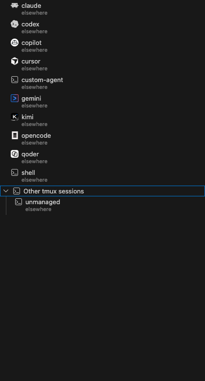
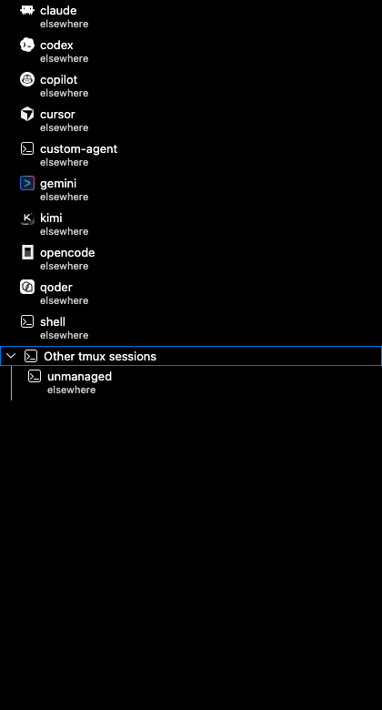
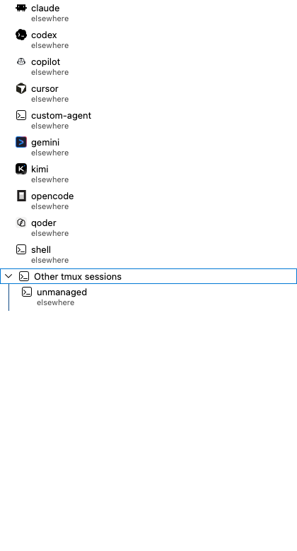
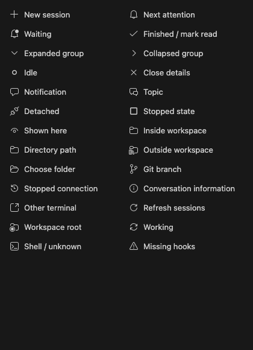
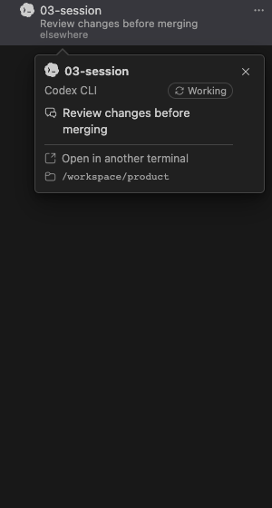

# Icon review

Berth uses product marks to identify agents, Codicons to explain actions and
state, and its own terminal-and-wave symbol for the extension. A session's
accessible name includes the agent name; details also show that name as text.
Unknown agents and shells use the terminal symbol.

## Scope and decisions

The 2026-10-31 review covers all eight agent identities, the 26 functional glyphs used
by the webview and contributed commands, the folder picker, and Berth's sidebar
SVG and extension PNG. Terminal-title state markers (`●`, `◐`, `✓`) and
iTerm2 indicator/status sequences were checked in the core and retained; their
native rendering was not re-tested in this browser review. The starting point was HEAD `dfb47bf` plus the preceding
local details-card changes. Exact candidate hashes are in
[the evidence record](assets/icons/evidence.json).

| Finding | Resolution |
|---|---|
| All eight agents used invented coloured letters; Codex was a green X. | Replace letters with sourced product marks; prefer official assets and document third-party fallbacks. |
| Row and details rendered agent images separately. Unknown IDs could request nonexistent SVGs. | Use one allowlisted renderer, with a terminal fallback for unknown agents, shells and unmanaged sessions. |
| Agent identity was absent from the row's accessible name. | Include the model's agent display name. Keep decorative marks hidden from assistive technology. |
| `sync~spin` was passed directly into a web-font class, producing no glyph. | Split the glyph and modifier into `codicon-sync codicon-modifier-spin`; respect reduced motion. |
| Outside-workspace folders had different symbols in the picker and sidebar. | Use `folder-library` in both. |

The remaining functional glyphs retain their existing meanings and Codicons
source. Waiting and unread indicators retain their text and state colours.
Berth's terminal-and-wave mark is consistent between the sidebar and extension
icon and remains unchanged.

## Agent assets

Six products now use official assets. Claude Code and Codex retain product-specific
third-party renderings from Lobe Icons. Source channel and identity are separate:
an official extension may use a shared vendor mark, while a third-party library
may provide a more recognisable product-specific symbol. Neither the filename
nor the license alone establishes identity.

| Agent | Selected identity | Source channel and scope |
|---|---|---|
| Claude Code | Clawd pixel mascot | Lobe Icons `claudecode`; not the Claude chat-product starburst or Anthropic company mark. This is a mascot rendering, not a claim of an official standalone logo. |
| Codex CLI | Codex terminal product mark | Lobe Icons `codex`; not the generic OpenAI knot used by the sampled official editor extension. Not claimed to be a vendor-issued asset. |
| Gemini CLI | Rounded terminal frame and prompt | Official Gemini CLI repository, IDE companion asset; not the Gemini chat-product sparkle or Google company mark. |
| Cursor CLI | Cursor cube | Official Cursor brand package, 2D light/dark variants. Shared Cursor product mark, not a distinct CLI-only logo or Anysphere company mark. |
| GitHub Copilot CLI | Copilot robot | Official GitHub Copilot extension asset. Shared Copilot product mark, not GitHub’s Octocat. |
| Kimi CLI | Kimi CLI application badge | Official Kimi CLI repository’s web client. The CLI itself uses the K identity; it is not a separate Moonshot company logo. This source is the legacy CLI repository matching the adapter family, not a claim about a newly renamed successor. |
| OpenCode | OpenCode rectangular symbol | Official OpenCode brand SVGs, light/dark variants; not the Anomaly company mark. |
| Qoder CLI | Qoder application mark | Official Qoder site favicon. Shared Qoder product identity, not an Alibaba company mark or a separately invented CLI logo. |

The [asset manifest](../packages/vscode/media/agents/sources.json) records exact
URLs, archive members, revisions or versions, and SHA-256 values. The
[third-party notices](../packages/vscode/THIRD_PARTY_NOTICES.md) preserve the
applicable licenses and distinguish product trademark assets from MIT/Apache
repository assets. All selected files are copied unchanged. Official artwork
keeps its colours; supplied light/dark variants follow the editor theme.

Identity references, checked on 2026-10-31: [Claude Code](https://github.com/anthropics/claude-code),
[Lobe Icons product asset sources](https://github.com/lobehub/lobe-icons),
[Codex CLI](https://github.com/openai/codex),
[Gemini CLI](https://github.com/google-gemini/gemini-cli),
[Cursor branding](https://cursor.com/brand),
[GitHub Copilot](https://marketplace.visualstudio.com/items?itemName=GitHub.copilot),
[Kimi CLI](https://github.com/MoonshotAI/kimi-cli),
[OpenCode branding](https://opencode.ai/brand), and [Qoder](https://qoder.com/).
Product identity references do not confer an endorsement or make a third-party
rendering an official file.

## Rendered evidence

The screenshots use the built webview, synthetic sessions and Chrome. Agent
marks render at their actual 16px size. The function sheets are diagnostic
catalogs of the bundled font, not an additional product screen.

## Verification

The product-identity revision passed the targeted icon checks recorded in
[the evidence JSON](assets/icons/evidence.json): both 1440×900 and 1280×800
outer viewports, four themes, every product mark, terminal fallbacks, identical
row/details mappings, served asset bytes and accessible agent names. Functional
font/animation checks from the preceding run remain valid; those glyphs did not
change. The VS Code build and webview type check passed. The latest unit run
passed 31 cases; no core behaviour changed in this icon revision.

The extension-host keybinding, native menu, screen-reader, zoom and remote-host
checks listed in [the details review](session-details-review.md#verification-and-limits)
remain open. Browser accessibility assertions do not establish screen-reader
behaviour in VS Code. The local package is installed without reloading the
user's editor; installation hashes are recorded with the evidence.

[Return to development](../README.md#development)
