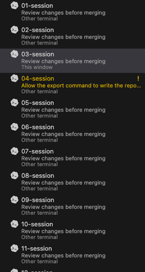
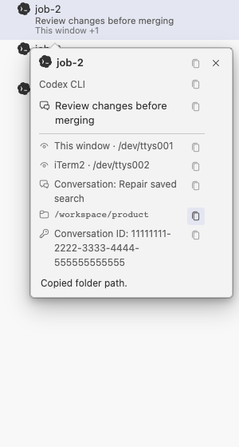
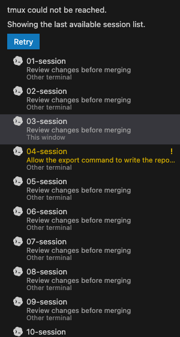
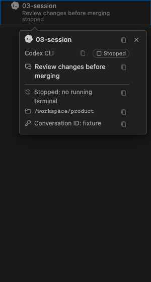

# Berth: product review and completion plan

Berth should help a developer find, understand and return to the correct agent
conversation while continuing to use their existing editor and terminal. That
is a coherent product. The [whole-code review](code-review.md) owns the current
repair status and evidence chain. Native host lifecycle, Linux execution and the
remaining agent/version matrix are still open; isolated checks do not complete
that gate.

[Iterations](iterations.md) defines the work and acceptance criteria. The
[specification](spec.md) owns product behavior. This report explains the findings,
their evidence and why each change matters.

## User and outcome

The primary user runs several independent agent conversations, sometimes in the
same folder, and moves between editor terminals and iTerm2. They need to answer:
which session is doing this work, which one needs me, where can I open it, and
will this action return me to the same conversation?

Completion means this user can install, discover or start, identify, open,
respond, leave running, recover, rename and deliberately end a session without
reconstructing system state from tmux commands or metadata files. A missing
capability must have an understandable boundary and next action.

A user with one agent and a satisfactory native resume picker may not need
Berth. Neither session count nor the number of supported logos proves value.
The useful outcomes are correct destinations, preserved conversations, fewer
search steps and clear recovery from failure. Measure those through task runs;
do not invent adoption or productivity figures.

## Product boundaries

| Keep | Why |
|---|---|
| Existing terminal/editor hosts | Preserve their editing, Git, accessibility and terminal workflows |
| Shared local core | Give the CLI and both hosts the same identity and recovery rules |
| Discovery independent of launch scripts | Accept an agent started by a terminal, a custom launcher or Berth |
| Exact conversation binding | Avoid selecting another conversation in the same directory |
| Compact inventory, details and native actions | Support finding and acting without another workbench |
| Reversible optional layout preset | Help users who want a session-first layout without making it a prerequisite |

Do not add a chat composer, terminal emulator, embedded browser, worktree/Git
manager, cloud sync or dashboard to make the product look complete. Each belongs
to another product unless an observed Berth task requires it. Search should use
one native session picker before consuming more sidebar space with filters.

## Alternatives and reference practices

| Alternative | Established capability | Berth's useful distinction |
|---|---|---|
| tmux plus terminal tabs | Shared live processes and manual attachment | Agent-aware discovery, attention and exact recovery in existing hosts |
| Agent-native history/resume | Authoritative conversations for one agent | A shared inventory across agents and hosts |
| cmux | Agent workspaces, notifications, tmux persistence and native agent resume | Integration inside an existing editor/iTerm2 workflow |
| GitLens | Git/worktree/agent context inside the editor | Process/session ownership and recovery rather than another Git interface |

The earlier statement that standalone terminals cannot share a live session
with an editor is not a valid differentiator. cmux's
[local tmux](https://github.com/manaflow-ai/cmux/blob/main/docs/local-tmux.md) and
[agent hooks](https://github.com/manaflow-ai/cmux/blob/main/docs/agent-hooks.md)
confirm that persistence and exact-ID recovery are competing capabilities.
Its recovery-failure feedback is a useful pattern to examine, not evidence that
Berth's implementation already has it. Sources checked 2026-11-01.

[VS Code's guidance](https://code.visualstudio.com/api/ux-guidelines/webviews)
requires a reason for custom webviews, host theme integration and accessible
controls. Multiline sessions and interactive details provide that reason here;
they also require explicit focus and keyboard behavior.
[GitLens's documented focus patterns](https://github.com/gitkraken/vscode-gitlens/blob/b87331422fe75f845ad32f581d2f500f72f84523/docs/webview-accessibility-patterns.md)
separate tree navigation from embedded controls. Apply the interaction principle;
do not copy proprietary UI assets or recreate GitLens's workbench.

## System model: what must stay distinct

| Object | Its job | Failure if confused |
|---|---|---|
| tmux session | Live process container and attach target | A live shell is mistaken for a restored agent |
| Agent producer | The process/pane allowed to report this conversation's events | Another pane overwrites the binding |
| Conversation ID | Exact native recovery target | A matching title or recent cwd selects the wrong conversation |
| Session name / conversation title / prompt excerpt | Stable user reference / native description / latest task text | Rename changes identity unexpectedly or duplicate text fills the view |
| Attached client | An actual live terminal connection | Detached is mistaken for stopped; simultaneous clients disappear |
| Restore owner | The host/workspace responsible for reopening | A viewing client silently becomes owner, even when opening fails |
| Attention state | Whether the user should respond or review completion | Failed navigation clears unread work |
| Recovery attempt | Requested, confirmed, failed or unconfirmed restoration | Launching a command is reported as a successful resume |

These dimensions should remain independent in core. The view selects the few
that help the current task; it should not expose every implementation field.
One row cannot safely promise independent recovery of several agents inside one
tmux session. The minimum design must detect that conflict, preserve evidence
and avoid guessing; arbitrary multi-pane restoration is outside this iteration.

## Findings across the complete journey

Diagnostic baseline: HEAD `dfb47bf` plus the measured working tree on
2026-11-01. The old failures below are superseded by the listed implementations;
[the product-review evidence](assets/product-review/evidence.json) identifies the
source, build and captures from that review, not the latest code candidate.
Current repair evidence is linked from the [whole-code review](code-review.md). The [prior baseline](assets/product-review/baseline/evidence.json)
retains the earlier fingerprints and captures.

| Journey | Candidate behavior | Remaining acceptance |
|---|---|---|
| Install and understand readiness | Native Diagnose Problems uses core findings; hooks install through the persistent bundled runtime. | Clean install, upgrade and actual hook invocation. T7/T9 |
| Discover existing work | Inspect independent producers across panes; reject conflicting adapter, pane, process or conversation events. Unknown process formats cannot replace an existing ID. | Installed agent versions and unsupported-format boundaries. T1/T8 |
| Identify work | Prefer task/title context, remove duplicate descriptions, show the shared branch once and copy full values. | Native zoom and screen-reader use. T5 |
| Open a session | Confirm the exact terminal client before clearing unread or changing ownership. | Real editor attachment and failure feedback. T3 |
| Open beside / detach | Use the same success contract; detach only clients belonging to this window, including manual clients. | Native simultaneous-host journey. T3/T9 |
| Attend to work | Guard lifecycle events and retain next-attention navigation with one error path. | Live hook lifecycle and notification dispatch. T1/T9 |
| Find a known session | Natural ordering plus a native name/title/folder picker. | Native keyboard, cancellation and no-match cases. T6 |
| Move between hosts/windows | Register live workspace/PID evidence separately from restore ownership; require explicit opening for legacy records. | Two windows, workspace changes, stale records and remote host. T4 |
| Recover interruption | Distinguish request, acknowledgement, failure and no confirmation; skip unsafe fallback; retry exact ID or relocate a stopped record. | Real-agent rejection, restart and reboot. T2/T9 |
| Rename | Persist the new name, roll back on snapshot failure and update host/unread references; reconcile external rename. | Native tab/reference refresh. T3 |
| End / forget | Explicit End removes the last restore record; Forget remains scoped to a stopped record. | Full host lifecycle. T2/T9 |
| Upgrade and scale | Batch stores, bound subprocesses and sample asynchronously; keep adapter implementation separate from version verification. | Native package and remote acceptance. T8/T9 |

Code evidence: [hook handling](../packages/core/src/agents/hooks.ts),
[discovery](../packages/core/src/registry/discover.ts),
[controller actions](../packages/vscode/src/controller.ts),
[restore](../packages/core/src/restore/ensure.ts),
[snapshot format](../packages/core/src/snapshot/store.ts), and
[host presentation](../packages/vscode/src/extension.ts).

### Superseded diagnostic failures

- Two independent panes, adapter metadata `claude`, then a Codex start event:
  the resulting pair was `claude` / `codex-two`. The invariant is broken before
  any actual resume is attempted.
- Opening a managed session through a host that throws: unread became false
  and owner changed from iTerm2 to VS Code despite the failed open.
- Renaming `before` to `after`: live name became `after`; snapshot and host map
  remained `before`. The probe did not need a reboot to demonstrate the mismatch.

Producer guards and action-transaction tests now cover these failures. The probes
remain evidence of the earlier baseline, not assertions about the current tree.

## Visual and interaction assessment

The current render uses the host theme, recognisable product assets, attention
colour and a stable details surface. Pointer transit, text selection, focus,
Escape and small-width wrapping have automated evidence. Those are foundations;
they do not establish that finding the right conversation is easy.

1. **Inventory.** Rows retain the stable session name and the reason to act.
   The shared branch moves to the folder heading, or the native view description
   for a flattened workspace. Long task text truncates in the list and remains
   available in details.

   

2. **Details.** Task text leads; the exact conversation ID follows the folder
   and branch. Each data value has a compact Copy control with host success or
   failure feedback. The close button has its own lane throughout scrolling,
   so long values and copy buttons cannot slide underneath it.

   

3. **Empty entry — actionable, not full onboarding.**
   New Session is keyboard-accessible. Missing prerequisites and discovery
   failure must not collapse into this normal empty state. This capture does
   not certify the native folder/agent picker or installation experience.

   

4. **Failure.** The listing error explains stale rows and offers Retry.
   Session recovery has separate requested, failed and unconfirmed states, with
   exact-ID Retry Recovery and Choose Recovery Folder actions. Native dispatch
   of these actions still needs acceptance.

   

5. **Stopped.** A stopped row remains distinct from a detached live agent.
   Reconstructing its process requests recovery; only a matching agent hook
   confirms the expected conversation. Unbound records stay stopped.

   

The fixtures are synthetic and intentionally deterministic. Repeated sample
text is not evidence about real task comprehension. Validate varied, duplicate,
long and missing descriptions through find/open/return tasks at 5, 20 and 100
sessions. Keep dark/light/high-contrast, narrow width, keyboard, zoom and screen
reader acceptance separate; screenshots alone cannot certify accessibility.

## Architecture and maintainability

Keep identity, lifecycle, ownership, capabilities and recovery decisions in the
core. Hosts supply process/workspace identity and native actions. The webview
renders and requests actions. Private launchers may align names but must not
become a requirement for discovery or recovery.

Use a producer identity and explicit action completion before adding more
booleans to rows. Core findings should drive both the CLI and host health
presentation. Group repeated process/store reads, bound child processes and
coalesce sampling. A slow filesystem or unreadable agent store should produce
an explicit unavailable value rather than freeze navigation or guess a binding.

Preserve user's control: optional layout, explicit hook installation, scoped
terminal actions, no surprise global setting restoration, no background model
requests and no transmission of session content. Versioned local fixtures and
failure injection complement live checks; neither replaces the other.

## What is done when

Follow [the iteration tasks](iterations.md), in dependency order. Each task has
an owner, reason, scope and acceptance conditions. A complete candidate must
pass the whole install-to-end journey and the critical adversarial cases, with
native-host and supported-agent evidence recorded. Optional environments can
remain explicitly unsupported; known critical identity/recovery defects cannot
be relabelled as merely “needs testing”.

Further additions need an observed user task that the existing host and session
contract cannot support.

[Spec](spec.md) · [Iterations](iterations.md) · [Implementation](implementation.md) ·
[Details review](session-details-review.md) · [Icon review](icon-review.md) ·
[Return to development](../README.md#development)
