# Session details review

The details card supports a specific decision: identify a session, read what it
needs, and inspect its branch and directory before opening that session. You
can now enter the card, read or copy its contents, and dismiss it without
switching terminals. The behaviour contract belongs to [the specification](spec.md);
this review records the evidence and design decisions.

## Scope and baseline

Reviewed on 2026-10-31: the VS Code session and folder details cards, including
their content model, pointer and keyboard behaviour, placement, scrolling,
themes, refresh lifecycle and extension-host dismissal. Session launch and
restoration are outside this review.

The baseline was HEAD `dfb47bf` plus the preceding local horizontal-position
change, captured at 21:24 +08:00. Chrome rendered the production webview bundle
with synthetic `buildTree` models and theme variables. The screenshots below
come from that browser run, not from a live editor window. The final candidate
is identified by the hashes in [the evidence record](assets/session-details/evidence.json).

## Findings and decisions

| Priority | Baseline problem | Corrected behaviour |
|---|---|---|
| High | Leaving the row closed the card across a 9px gap. | One owner retains the card across the row, transition corridor and popup; a slow crossing has no deadline. |
| High | Escape was ineffective with focus outside the row; no keyboard details entry existed. | Row focus opens details; Tab enters; Shift+Tab or Escape returns. A host command handles dismissal while terminal focus remains outside the webview. |
| High | A long fixture reached 1945px high in a 560px sidebar; horizontal content reached 1091px. | Text wraps; the viewport limits card dimensions; an inner scroller exposes the remaining content. |
| Medium | The full path depended on a second native tooltip. | The card displays the full selectable path. |
| Medium | The card kept an old snapshot after model changes. | Relevant updates refresh it; unrelated updates preserve selection; keyed rows retain the source identity. Removing the source closes it. |
| Medium | Closing could expose another row and reopen its card without pointer movement. | Dismissal suppresses hover reopening at the same pointer position. A new pointer movement or keyboard focus is required. |
| Medium | Measuring unconstrained height during resize reset the reading position. | Positioning reads content height without removing the scroll constraint. |
| Medium | A fixed close button could cover scrolled text in a narrow card. | A reserved control gutter keeps text outside its hit area. |
| Medium | A shell could show an agent conversation-binding warning. | That warning applies to agent sessions only. |

### 1. Trigger and enter

Baseline: the popup looked reachable, but moving through the gap removed it.
The second frame shows the same area after that crossing.

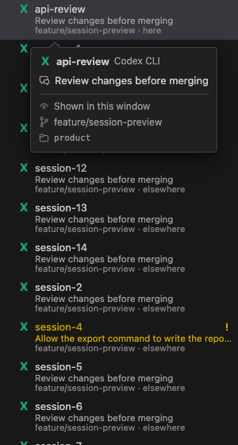
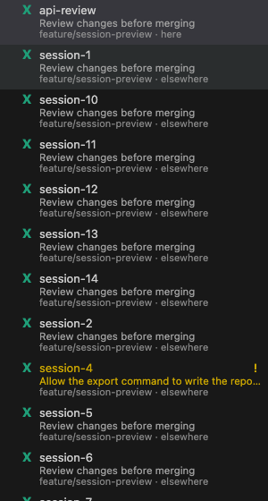

The revised card keeps the established opening delay. A geometry check protects
only the space between the source and the card; it adds no invisible element
that intercepts another row's click. Leaving both regions schedules closure.
Text selection and keyboard focus retain the card.

### 2. Read and copy

The card presents identity and state first, then the notification and topic,
then connection, branch, directory and relevant warnings. Empty branches do not
produce placeholder rows. A shell does not receive agent-only warnings. The
card has no duplicate launch, rename or delete controls; those remain with the
session and its native context menu.

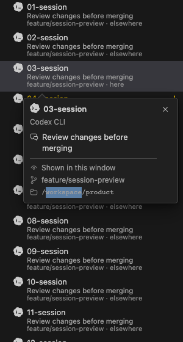
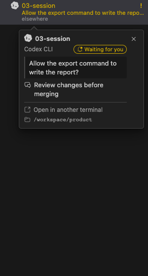

Text enters the DOM through `textContent`. The browser suite checks literal
markup and non-Latin text, selects the contents, invokes native copy, and reads
back the resulting clipboard text.

### 3. Use the keyboard and dismiss

The panel has `role="dialog"`, `aria-modal="false"` and an accessible name.
Opening it does not take focus. Tab from the source enters its scrollable
content; Shift+Tab returns to the source. Escape and the close button dismiss
it and restore source focus when focus was inside. Forward Tab can leave the
panel; focus is not trapped. Ctrl/Cmd+A inside it selects the details rather
than the entire session list.

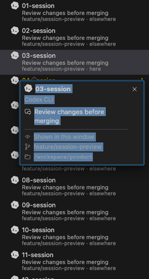

The extension receives visibility messages and enables an Escape command only
while the card is visible. That command sends a dismissal message back to the
webview. Hide and disposal clear the host context. This covers the architecture
needed when the terminal owns keyboard focus; native keybinding dispatch still
needs the host check described below.

### 4. Fit the available space

The left edge remains offset from the source's icon column. The card chooses
below or above based on available space and bounds its width and height to the
webview. If neither side offers a useful reading area, it fits inside the
viewport and omits the arrow. Long content scrolls inside the card; list scroll
closes it. Resizing preserves the reading offset where the new dimensions allow.

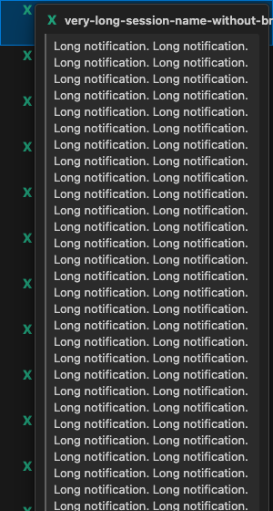
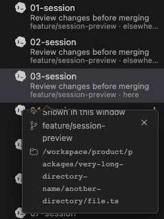
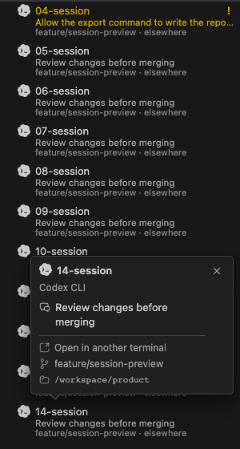
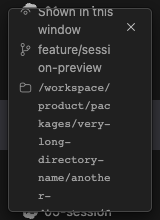

### 5. Preserve visual and data context

Colours come from the existing VS Code theme variables; functional icons remain Codicons
and agent marks follow the [icon review](icon-review.md). Border, shadow and horizontal offset distinguish
the card from the list. The pointer marks its source. A 24px close control stays
available while the contents scroll. State text accompanies colour.

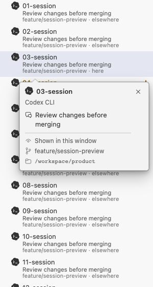
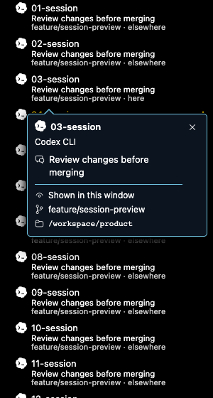
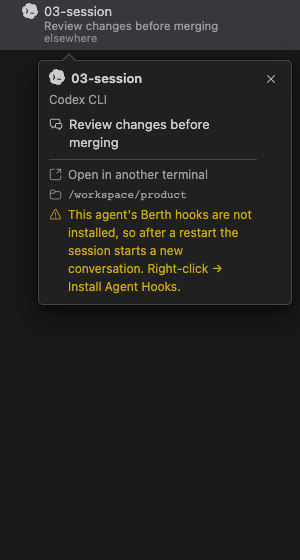

Model updates retain the active source by ID. Changing another row preserves
selection; changing the source updates its details; removing or scrolling it
out of view closes the card. Window blur, outside click and an outside context
menu also close it. Event listeners and timers are disposed with the view.

## Architecture

| Owner | Responsibility |
|---|---|
| `src/model.ts` | Decide which session facts and warnings apply. |
| `webview/main.ts` | Render keyed rows and route source, focus and model changes. |
| `webview/hover.ts` | Own pending/open/closing/dismissed behaviour, focus, selection and rendering. |
| `webview/hoverPosition.ts` | Calculate constrained placement and the pointer transition region. |
| `webview/main.css` | Apply shared theme tokens, wrapping, scrolling and visible focus. |
| `src/view/*`, `src/extension.ts` | Carry visibility and dismissal across the webview/host boundary. |

The implementation uses the existing Lit view and message protocol. Playwright
is a development dependency for browser acceptance; the runtime adds no UI
framework or positioning dependency.

## Reference decisions

- W3C's [WCAG 2.2 explanation of content on hover or focus](https://www.w3.org/WAI/WCAG22/Understanding/content-on-hover-or-focus.html)
  supplies the dismissible, hoverable and persistent checks. This review does
  not claim complete WCAG conformance.
- The [WAI-ARIA tooltip pattern](https://www.w3.org/WAI/ARIA/apg/patterns/tooltip/)
  distinguishes a non-focusable tooltip from a popup with focusable content.
  Its pattern is explicitly marked work in progress. Berth uses a non-modal
  dialog because the user can enter a scroller and close control.
- [Floating UI's hover documentation](https://floating-ui.com/docs/usehover)
  explains pointer transit protection. Berth uses a bounded gap corridor and
  closing delay, without installing its React hooks or intercepting clicks
  through an overlay.
- [VS Code's hover widget source](https://github.com/microsoft/vscode/blob/main/src/vs/base/browser/ui/hover/hoverWidget.ts)
  provides a concrete reference for scrollable hover content and keyboard
  access. Berth retains the existing VS Code theme variables and icons.
- [Radix Hover Card](https://www.radix-ui.com/primitives/docs/components/hover-card)
  states that its hover content is intended for sighted users and inaccessible
  to keyboard users. That boundary does not suit this card's reading task.

Sources were checked on 2026-10-31. The links to implementation branches can
change; they support the design principles above, not a claim of identical
implementation.

## Verification and limits

The details baseline browser run passed all 54 cases in 38.3 seconds. Later product-asset changes are verified separately in the [icon review](icon-review.md). All 29 VS Code unit
tests passed in 6.8 seconds. The build passed, and the installed extension and
webview bundles match the reviewed build by SHA-256. Native host checks remain
open. Exact hashes and timings are recorded in the evidence JSON. Run the checks
from the repository root after building:

```sh
npm run build
npm run test:webview -w berth
node --test --test-concurrency=1 'packages/vscode/dist-test/test/*.test.js'
```

The browser suite covers 1440×900 and 1280×800 outer viewports; dark, light and
high-contrast themes; 240/300/420px sidebars; a 160px resize case; long content;
mouse entry, exit and selection; keyboard focus and copy; source updates and
removal; host dismissal messages; and session-state variants. Each case gets
an isolated browser context. Failure traces remain separate from accepted
screenshots. The suite uses synthetic sessions, not the user's live sessions.

The remaining host checks are real VS Code Escape routing while terminal focus
is active, native Copy menu dispatch, screen-reader announcements, editor zoom
and remote-host behaviour.
Browser message tests do not establish those outcomes. Human acceptance remains
open; this review does not mark the existing manual cases V8/V15 as passed.

[Return to development](../README.md#development)
